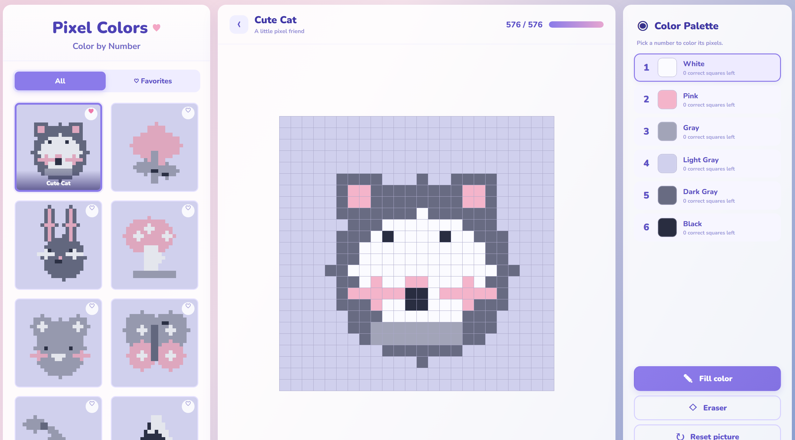
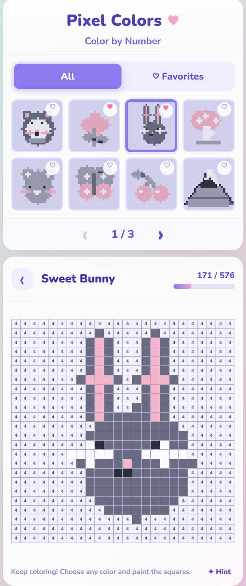

# Pixel Colors 🎨

A cozy pixel-art color-by-number game built with HTML, CSS, and vanilla JavaScript. No React or build tools required.

Choose a picture, select the matching palette color, and fill in numbered pixels to bring each piece of pixel art to life.

## Features

- Responsive pastel-themed three-panel layout
- Eight original pixel-art pictures
- Color-by-number gameplay with numbered pixels
- Progress counter to track coloring progress
- Fill all remaining pixels for a selected color
- Eraser, reset, and hint tools
- Favorites and page navigation
- Progress and favorites saved using browser local storage
- Keyboard shortcuts: `1`–`6` to select colors
- Responsive design for desktop and mobile devices

## Run Locally

1. Clone or download the repository.
2. If downloaded as a ZIP file, extract the project folder.
3. Open `index.html` in your browser, or open the folder in VS Code and use the Live Server extension.
4. Choose a picture, select a palette color, and click the matching numbered pixels.

## Screenshots

### Desktop Version:

### Mobile Version:

## Project Structure

- `index.html` — page structure and content
- `style.css` — layout, styling, and responsive design
- `script.js` — pixel-art definitions and game logic

## Technologies Used

- HTML5
- CSS3
- Vanilla JavaScript
- Browser Local Storage

---

Created as a personal project to practice Front-end development and build an interactive, responsive browser game.